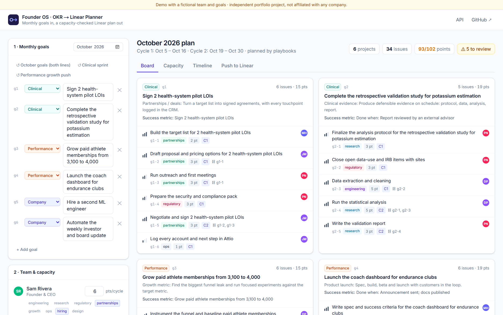
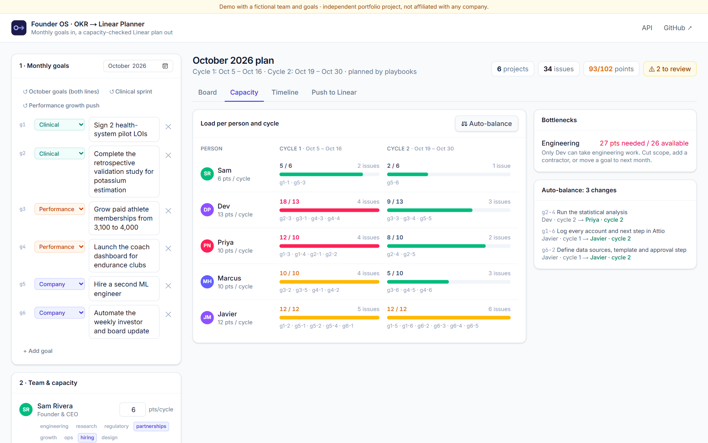
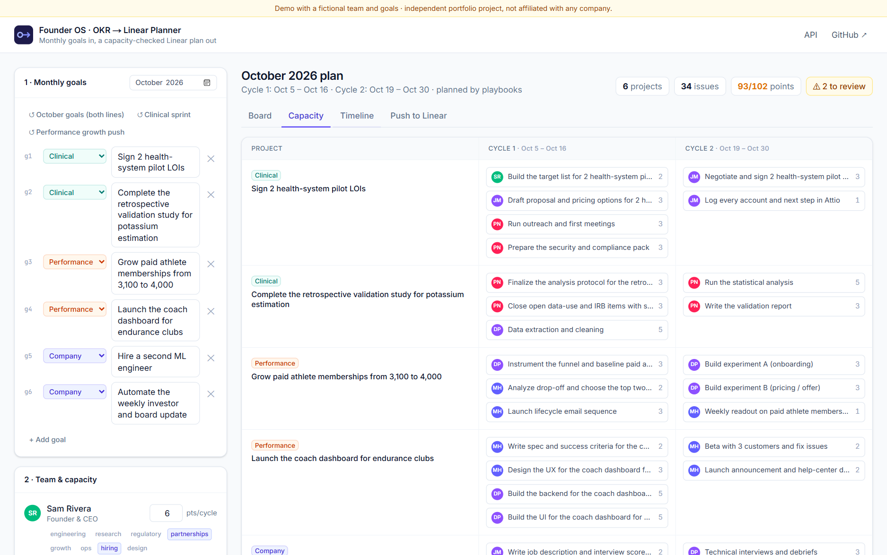
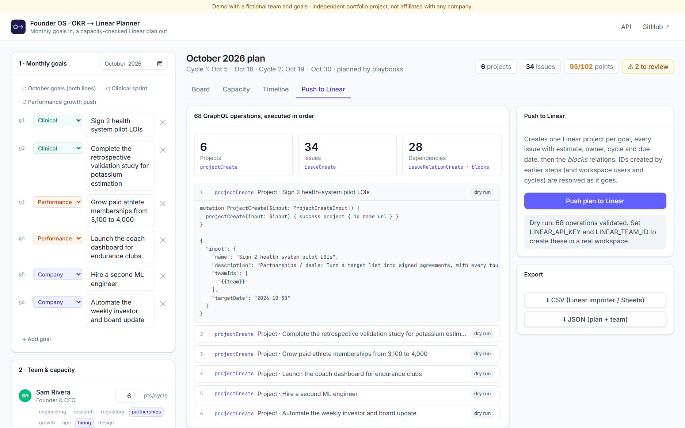
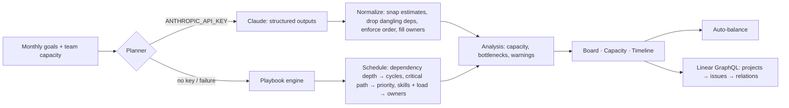

# OKR → Linear Planner

**Turn a founder's monthly goals into a capacity-checked Linear plan: projects, issues, estimates, owners, cycles and dependencies, pushed to Linear in one click.**

[](https://okr-to-linear.vercel.app)
[](https://github.com/JavierMonestel/okr-to-linear/actions/workflows/ci.yml)




> **Try it:** [okr-to-linear.vercel.app](https://okr-to-linear.vercel.app). The plan for six October goals is already generated. Open an issue to reassign it, check **Capacity**, hit **Auto-balance**, look at the **Timeline**, then **Push to Linear** to see the exact GraphQL that would run (the hosted demo is a dry run). Switch goal templates or write your own and regenerate.

---

## Why

"Auto-populate Linear from monthly goals" sounds like a 10-minute job. In practice it is half a day every month:

1. break each goal into deliverables a team can actually ship,
2. size them, give each one an owner with the right skills, and spread them across cycles,
3. check that **no one is overloaded** and that **nothing is scheduled before what blocks it**,
4. then type it all into Linear: projects, issues, estimates, assignees, cycles and relations.

This app does steps 1–4 in seconds and keeps the founder (or their chief of staff) in control of the result.

## Features

| | |
|---|---|
| **Goals → projects → issues.** One Linear project per goal with a success metric, and 4–7 issues per goal with estimates (1/2/3/5/8), kind, priority and `blocks` dependencies. Generated by **Claude** (structured outputs) or, with no API key, by a **playbook engine** (deals, evidence, regulatory, growth, launch, hiring, automation). |  |
| **Capacity check.** Points per person per two-week cycle against their capacity, plus a **bottleneck** read-out by skill ("only Dev can take engineering work: 27 pts needed, 26 available"). |  |
| **Auto-balance.** Hands work to a teammate with the right skill and room, or defers leaf issues to the next cycle, **without breaking a dependency**. Shows exactly what moved. |  |
| **Timeline.** Projects × cycles with owners, so the month reads at a glance. |  |
| **Push to Linear.** Ordered GraphQL operations: `projectCreate` → `issueCreate` (estimate, priority, assignee, cycle, due date) → `issueRelationCreate` (`blocks`). Workspace users and cycles are matched by name and date. Dry run without credentials; CSV and JSON export either way. |  |

Every edit is re-validated live: over-capacity, dependency order, unassigned work and skill mismatches show up in a "to review" list.

## How it works



- **The model's output is never trusted blindly.** Estimates are snapped to the Fibonacci scale, unknown assignees are re-assigned by skill and load, dependencies pointing at non-existent issues are dropped, and the cycle order is enforced, all by the same deterministic code the playbook engine uses.
- **Critical path → priority.** The longest weighted dependency chain of each goal is marked High; supporting work is Medium; one-point chores are Low.
- **Placeholders for IDs that don't exist yet.** Operations reference `{{project:g1}}`, `{{issue:g1-2}}`, `{{user:dev}}` and `{{cycle:1}}`; the push route resolves them as earlier calls return. Unknown optional IDs (for example, a cycle that doesn't exist in the workspace) are omitted rather than sent.

## Run it locally

```bash
git clone https://github.com/JavierMonestel/okr-to-linear.git
cd okr-to-linear
npm install
cp .env.example .env.local   # optional keys
npm run dev
```

| Variable | Effect |
|---|---|
| `ANTHROPIC_API_KEY` | Plan with Claude (`claude-opus-5-5`); otherwise the playbook engine |
| `LINEAR_API_KEY`, `LINEAR_TEAM_ID` | Push creates real projects, issues and relations in that team |

```bash
npm test            # 22 Vitest tests: playbooks, scheduling invariants, auto-balance, Linear ops, CSV
npm run typecheck
npm run lint
```

### API

| Endpoint | Body | Returns |
|---|---|---|
| `POST /api/plan` | `{ month, goals[], team[] }` | `Plan` (projects, issues, cycles) |
| `POST /api/linear/push` | `{ plan, team }` | Per-operation results (`created` / `dry_run` / `error`) |

A natural automation: on the first Monday of the month, a Make/Zapier/n8n scenario reads the month's goals from Notion, calls `/api/plan`, posts the capacity summary to Slack for a quick review, and then calls `/api/linear/push`.

## Project structure

```
src/lib/
  playbooks.ts   goal archetypes → step templates with estimates and dependencies
  planner.ts     rules planner, scheduling (cycles, critical path, owners), dependency enforcement
  analysis.ts    capacity table, warnings, auto-balance
  ai.ts          Claude planner + normalization
  linear.ts      GraphQL operations, placeholder resolution, CSV
src/components/  Board, CapacityView, Timeline, PushPanel, editors
src/app/api/     /plan and /linear/push route handlers
```

---

**Built by [Javier Monestel](https://github.com/JavierMonestel)** as part of a portfolio on AI-native operations for an early-stage, two-vertical health-tech company.
*Independent project. Not affiliated with, endorsed by, or built for any company. The team and goals in the demo are fictional.*
